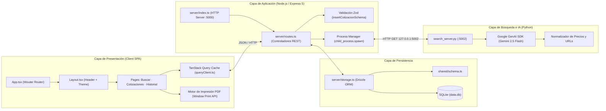
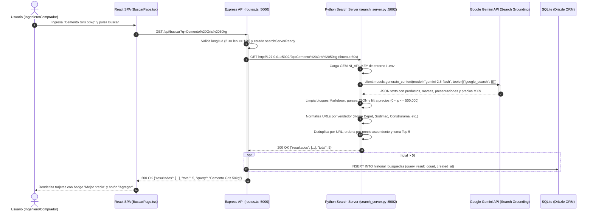
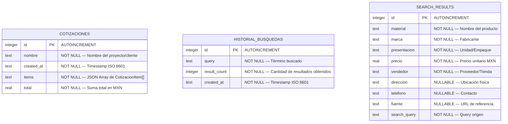

# 📘 Documento Técnico de Ingeniería — Sistema CotizaObra (`cotizadora-app`)

**Autor:** Roberto Alejandro Chagra Martínez  
**Versión:** 2.0 (Edición Google Gemini)  
**Estado:** Especificación de Arquitectura y Diseño Técnico  
**Dominio:** Ingeniería Civil / Procura y Presupuestación de Materiales de Construcción (ZMG, México)

---

## 1. Resumen Ejecutivo y Alcance

**CotizaObra (`cotizadora-app`)** es una plataforma web Full-Stack diseñada para resolver la asimetría de precios en el mercado de materiales de construcción en la **Zona Metropolitana de Guadalajara (ZMG)** y México. Permite consultar precios minoristas y mayoristas en tiempo real mediante **Google Gemini (`google-genai`) con Google Search Grounding**, estructurar presupuestos cuantificados por partida y emitir documentos de cotización en formato PDF.

### 1.1 Objetivos Técnicos del Sistema
1. **Independencia de APIs Propietarias Cerradas**: Sustitución total del SDK privado de Perplexity (`pplx_sdk`) por el SDK estándar de **Google Gemini (`google-genai`)** con búsqueda fundamentada (*Grounding with Google Search*) y soporte secundario mediante `duckduckgo-search` + `Pydantic`.
2. **Latencia Controlada mediante Microservicio Persistente**: El motor de búsqueda en Python se ejecuta como un demonio HTTP persistente (`127.0.0.1:5002`) administrado por el proceso principal de Node.js, evitando la sobrecarga de inicializar el intérprete de Python y los clientes TLS en cada petición.
3. **Integridad de Datos y Tipado Compartido**: Uso de un esquema único ([`shared/schema.ts`](file:///g:/Mi%20unidad/Drive.alumno.udg.mx/Proyectos/cotizadora-app/shared/schema.ts)) con **Drizzle ORM** y **Zod** compartido entre el cliente React y el servidor Express.
4. **Resiliencia de Enlaces Externos**: Normalización determinista de URLs hacia los motores de búsqueda internos de las tiendas verificadas para evitar hipervínculos rotos (`HTTP 404`) producto de URLs efímeras o alucinaciones del modelo.

---

## 2. Comparativa Técnica de Repositorios (`cotizaobra` vs `cotizadora-app`)

Se realizó una auditoría forense línea por línea entre ambos repositorios. El frontend (`client/`), el esquema compartido ([`shared/schema.ts`](file:///g:/Mi%20unidad/Drive.alumno.udg.mx/Proyectos/cotizadora-app/shared/schema.ts)) y el empaquetador ([`scripts/build.ts`](file:///g:/Mi%20unidad/Drive.alumno.udg.mx/Proyectos/cotizadora-app/scripts/build.ts)) son 100% idénticos; las diferencias críticas radican en el motor de IA, la capa de base de datos y la higiene del repositorio:

| Dimensión Técnica | `RobbeAlex/cotizaobra` | `RobbeAlex/cotizadora-app` | Evaluación y Veredicto |
| :--- | :--- | :--- | :--- |
| **Motor de IA / LLM** | ❌ **Perplexity (`pplx_sdk`)** (`pplx_sdk.search.web`, `content.snippets`, `llm.extract`) | ✅ **Google Gemini (`google-genai`)** con `google_search` Grounding + Pydantic | **Gana `cotizadora-app`**: Cumple la restricción de no usar Perplexity y emplea Gemini. |
| **Estrategia de Búsqueda Web** | Dependiente al 100% de servidores proxy internos de Perplexity (`agent-proxy.perplexity.ai:50051`). | Doble motor: **Gemini Search Grounding** en [`search_server.py`](file:///g:/Mi%20unidad/Drive.alumno.udg.mx/Proyectos/cotizadora-app/server/search_server.py) y **DuckDuckGo + Gemini 2.5 Flash** en [`search_web.py`](file:///g:/Mi%20unidad/Drive.alumno.udg.mx/Proyectos/cotizadora-app/server/search_web.py). | **Gana `cotizadora-app`**: Mayor portabilidad y facilidad de obtener credenciales (`GEMINI_API_KEY`). |
| **Prevención de URLs 404** | Devuelve la URL cruda extraída por el LLM. | Normaliza URLs hacia los buscadores internos de Home Depot, Sodimac, Construrama, Amazon y MercadoLibre. | **Gana `cotizadora-app`**: Garantiza que el botón *"Ver en tienda"* siempre lleve a productos válidos. |
| **Driver SQLite (`storage.ts`)** | ✅ `better-sqlite3` (síncrono, coincide con la firma de `IStorage` y `routes.ts`). | ⚠️ `@libsql/client` (asíncrono, pero invocado sin `await` en `routes.ts`). | **Gana `cotizaobra`** en estabilidad de BD (o requiere agregar `async/await` en `cotizadora-app`). |
| **Compatibilidad ESM / Windows** | Usa `spawn("python3", ...)` y `__dirname` implícito. | Define `__dirname` vía `fileURLToPath(import.meta.url)` y usa `spawn("python", ...)`. | **Gana `cotizadora-app`**: Compatible nativamente con Windows y Node ESM. |
| **Documentación y Archivos Base** | ✅ Incluye `README.md` detallado (224 líneas), `LICENSE` MIT y `.env.example`. | ✅ Documentación técnica unificada, `LICENSE` MIT y `requirements.txt`. | **Empate tras actualización**: Documentación completa en raíz y `docs/`. |
| **Limpieza del Repositorio** | ✅ Raíz limpia, sin archivos basura. | ✅ Se eliminaron los **14 archivos temporales `scratch_*`** en la raíz (`scratch_bing.py`, `scratch_html.html`, etc.). | **Empate tras limpieza**: Raíz depurada y organizada. |

> [!IMPORTANT]
> **Hallazgo Crítico de Ingeniería detectado durante la auditoría de `cotizadora-app`**:
> 1. **Asíncronía en `storage.ts`**: En [`cotizadora-app/server/storage.ts`](file:///g:/Mi%20unidad/Drive.alumno.udg.mx/Proyectos/cotizadora-app/server/storage.ts#L1-L97), se migró de `better-sqlite3` (síncrono) a `@libsql/client` (asíncrono). Sin embargo, en [`routes.ts`](file:///g:/Mi%20unidad/Drive.alumno.udg.mx/Proyectos/cotizadora-app/server/routes.ts#L128-L150) las llamadas `res.json(storage.getCotizaciones())` no tienen `await`, lo que serializa una `Promise` vacía (`{}`) en lugar de los registros reales. **Solución**: añadir `async/await` en `routes.ts` y `storage.ts`, o mantener `better-sqlite3`.
> 2. **Nombre del modelo en `search_server.py`**: En la línea 150 de [`search_server.py`](file:///g:/Mi%20unidad/Drive.alumno.udg.mx/Proyectos/cotizadora-app/server/search_server.py#L149-L155) figura `model='gemini-3.6-flash'`, mientras que en [`search_web.py`](file:///g:/Mi%20unidad/Drive.alumno.udg.mx/Proyectos/cotizadora-app/server/search_web.py#L174-L181) se usa correctamente `model='gemini-2.5-flash'`. Se recomienda parametrizar el modelo mediante `os.environ.get("GEMINI_MODEL", "gemini-2.5-flash")`.

---

## 3. Arquitectura Detallada del Sistema

### 3.1 Diagrama de Componentes y Capas



### 3.2 Diagrama de Secuencia — Flujo de Búsqueda con Gemini Grounding



---

## 4. Diseño del Motor de Inteligencia Artificial (Gemini)

El repositorio `cotizadora-app` implementa dos estrategias complementarias en Python para la obtención de precios sin depender de Perplexity:

### 4.1 Estrategia A: Google Gemini con Search Grounding Nativo ([`server/search_server.py`](file:///g:/Mi%20unidad/Drive.alumno.udg.mx/Proyectos/cotizadora-app/server/search_server.py))
Es el motor principal utilizado en tiempo de ejecución por el servidor Express:
- **SDK**: `from google import genai` (`google-genai`).
- **Herramienta**: `types.GenerateContentConfig(tools=[{"google_search": {}}])`.
- **Ventaja**: Gemini ejecuta búsquedas en vivo en Google México, atravesando bloqueos anti-bot (Cloudflare/Akamai) que suelen afectar a scrapers tradicionales en sitios como Home Depot o Sodimac.
- **Post-procesamiento y Sanitización**:
  1. Limpieza de delimitadores markdown (` ```json ... ``` `).
  2. Conversión numérica segura a `float` y validación de rango lógico (`$1.00 <= precio <= $500,000.00 MXN`).
  3. **Reescritura determinista de enlaces de tienda**: Dado que las URLs de grounding de Vertex/Google (`vertexaisearch.cloud.google.com`) o los SKUs individuales pueden caducar, el servidor construye enlaces directos al motor de búsqueda interno de cada tienda con el nombre exacto del material codificado en URL (`urllib.parse.quote`):
     - **Home Depot**: `https://www.homedepot.com.mx/s/{q_enc}`
     - **Sodimac**: `https://www.sodimac.com.mx/sodimac-mx/search?Ntt={q_enc}`
     - **Construrama**: `https://www.construrama.com/search?text={q_enc}`
     - **MercadoLibre**: `https://listado.mercadolibre.com.mx/{q_enc}`
     - **Amazon México**: `https://www.amazon.com.mx/s?k={q_enc}`

### 4.2 Estrategia B: Búsqueda Híbrida DuckDuckGo + Gemini Structured Outputs ([`server/search_web.py`](file:///g:/Mi%20unidad/Drive.alumno.udg.mx/Proyectos/cotizadora-app/server/search_web.py))
Funciona como motor secundario o de línea de comandos (CLI):
- **Recuperación (Retrieval)**: Utiliza `duckduckgo_search.DDGS().text()` filtrando explícitamente por operadores `site:homedepot.com.mx OR site:sodimac.com.mx OR site:construrama.com...` en la región `mx-es`.
- **Extracción Estructurada (Structured Outputs)**: Pasa los fragmentos recuperados a `gemini-2.5-flash` configurando `response_mime_type="application/json"` y `response_schema=ProductosList` (definido con modelos `BaseModel` de **Pydantic**), garantizando por contrato un JSON válido al 100%.

---

## 5. Modelo de Datos y Persistencia (SQLite + Drizzle ORM)

El esquema relacional está centralizado en [`shared/schema.ts`](file:///g:/Mi%20unidad/Drive.alumno.udg.mx/Proyectos/cotizadora-app/shared/schema.ts) y se materializa en el archivo local `data.db`.

### 5.1 Diagrama Entidad-Relación (ERD)



### 5.2 Estructura del JSON `CotizacionItem` (embebido en `cotizaciones.items`)
```typescript
export type CotizacionItem = {
  material: string;      // Ej. "Cemento Gris Extra"
  marca: string;         // Ej. "CEMEX"
  presentacion: string;  // Ej. "Costal 50 kg"
  precio: number;        // Ej. 265.00
  vendedor: string;      // Ej. "Home Depot México"
  cantidad: number;      // Ej. 20
  subtotal: number;      // Ej. 5300.00 (precio * cantidad)
};
```

---

## 6. Especificación de la Capa Backend (`server/`)

### 6.1 Punto de Entrada ([`server/index.ts`](file:///g:/Mi%20unidad/Drive.alumno.udg.mx/Proyectos/cotizadora-app/server/index.ts))
- Configura middlewares `express.json()` (conservando `req.rawBody` en buffer) y `express.urlencoded()`.
- Implementa un **Interceptor de Telemetría HTTP** que mide la duración en milisegundos de cada llamada a `/api/*` y registra el código de estado junto con el payload JSON devuelto.
- En modo desarrollo (`NODE_ENV !== "production"`), monta el servidor Vite en modo middleware ([`server/vite.ts`](file:///g:/Mi%20unidad/Drive.alumno.udg.mx/Proyectos/cotizadora-app/server/vite.ts)) sobre el mismo `httpServer` para proveer HMR en el puerto `5000`. En producción, sirve el directorio `dist/public` mediante [`server/static.ts`](file:///g:/Mi%20unidad/Drive.alumno.udg.mx/Proyectos/cotizadora-app/server/static.ts).

### 6.2 Gestión del Ciclo de Vida del Subproceso Python ([`server/routes.ts`](file:///g:/Mi%20unidad/Drive.alumno.udg.mx/Proyectos/cotizadora-app/server/routes.ts))
- Al arrancar Express, `startSearchServer()` invoca `spawn("python", [SCRIPT_PATH])` inyectando las variables de `.env` y `SEARCH_PORT=5002`.
- Monitorea `stdout` hasta detectar la cadena `"listening"`, activando la bandera `searchServerReady = true`.
- Si una petición a `/api/buscar` llega durante el arranque en frío, Express espera dinámicamente hasta 10 segundos (sondeando cada 500 ms) antes de despachar la consulta.
- **Tolerancia a Fallos (Watchdog)**: El evento `proc.on("exit")` detecta caídas inesperadas del proceso Python, marca `searchServerReady = false` y programa un reinicio automático tras `3000 ms`.

---

## 7. Especificación de la Capa Frontend (`client/`)

### 7.1 Arquitectura de Componentes y Estado
- **Enrutamiento ([`client/src/App.tsx`](file:///g:/Mi%20unidad/Drive.alumno.udg.mx/Proyectos/cotizadora-app/client/src/App.tsx))**: Utiliza `wouter` con `useHashLocation` (`/#/`, `/#/cotizaciones`, `/#/historial`), lo que permite recargar la página en cualquier ruta sin requerir reglas de reescritura en servidores estáticos.
- **Gestión de Estado Remoto ([`client/src/pages/BuscarPage.tsx`](file:///g:/Mi%20unidad/Drive.alumno.udg.mx/Proyectos/cotizadora-app/client/src/pages/BuscarPage.tsx))**:
  - `useQuery(["/api/materiales"])`: Precarga el catálogo de sugerencias para autocompletado instantáneo en cliente.
  - `useQuery(["/api/buscar", searched])`: Ejecuta la búsqueda solo cuando `searched.length >= 2`, manteniendo los resultados en caché durante **5 minutos** (`staleTime: 300000 ms`) para evitar llamadas redundantes a Gemini.
- **Generación de Reportes PDF ([`client/src/pages/CotizacionesPage.tsx`](file:///g:/Mi%20unidad/Drive.alumno.udg.mx/Proyectos/cotizadora-app/client/src/pages/CotizacionesPage.tsx))**:
  - Construye un documento HTML5 autónomo con estilos CSS de impresión (`@media print`), tipografía `Inter`, encabezado corporativo terracota (`#C44E1F`), tabla desglosada y sumatoria total, disparando `window.print()` automáticamente al cargar.
