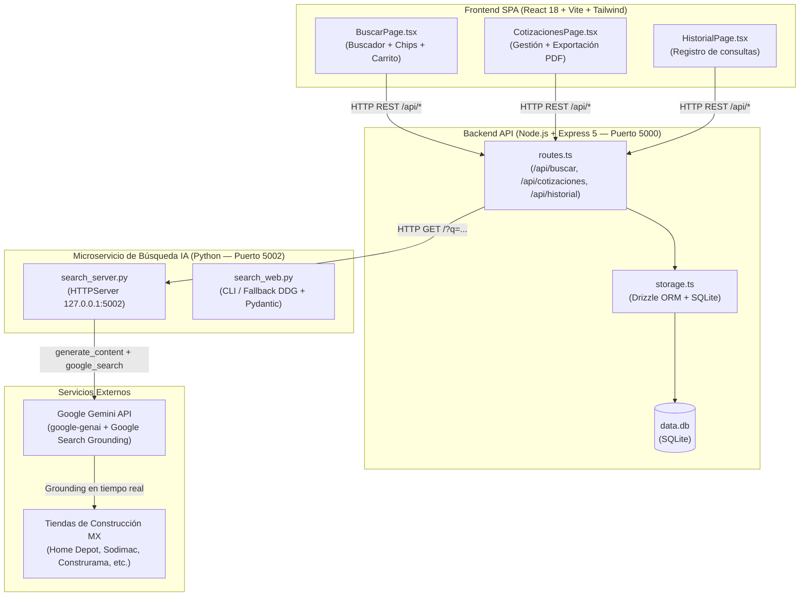

# 🏗️ CotizaObra (Cotizadora App) — Motor de Cotización en Tiempo Real con Google Gemini


Plataforma Full-Stack para **ingenieros civiles, arquitectos, contratistas y compradores de obra** que permite buscar precios de materiales de construcción en tiempo real en la **Zona Metropolitana de Guadalajara (ZMG) y México**, armar presupuestos interactivos y exportar cotizaciones formales en PDF utilizando **Google Gemini (`google-genai`) con Google Search Grounding**.

---

## 📋 Tabla de Contenidos

1. [Características Principales](#-características-principales)
2. [Arquitectura del Sistema](#-arquitectura-del-sistema)
3. [Stack Tecnológico](#-stack-tecnológico)
4. [Tiendas y Proveedores Soportados](#-tiendas-y-proveedores-soportados)
5. [Estructura del Proyecto](#-estructura-del-proyecto)
6. [Requisitos Previos](#-requisitos-previos)
7. [Instalación y Configuración Paso a Paso](#-instalación-y-configuración-paso-a-paso)
8. [Variables de Entorno](#-variables-de-entorno)
9. [Scripts Disponibles](#-scripts-disponibles)
10. [API Reference (Endpoints)](#-api-reference-endpoints)
11. [Compilación y Despliegue a Producción](#-compilación-y-despliegue-a-producción)
12. [Solución de Problemas (Troubleshooting)](#-solución-de-problemas-troubleshooting)
13. [Licencia](#-licencia)

---

## ✨ Características Principales

- 🔍 **Búsqueda Inteligente en Tiempo Real con Google Gemini**: Consulta cualquier material en lenguaje natural (*"cemento gris 50kg"*, *"cable THW calibre 12"*, *"tinaco 1100L"*, *"varilla corrugada 3/8"*) y obtiene las **5 mejores opciones** ordenadas de menor a mayor precio.
- 🌐 **Google Search Grounding + Fallback Híbrido**: Extrae precios actuales del mercado mexicano mediante la herramienta nativa `google_search` de Gemini y soporta búsqueda complementaria con DuckDuckGo + esquemas estructurados Pydantic (`ProductosList`).
- 🛡️ **Normalización Anti-Enlaces Rotos**: Convierte y valida las URLs de origen hacia búsquedas verificadas dentro de cada tienda oficial para evitar errores `404` por caducidad de SKUs.
- ⚡ **Autocompletado y Categorías Rápidas**: Más de 50 insumos preconfigurados organizados en 6 categorías de obra (*Obra gruesa, Acabados, Eléctrico, Plomería, Herrería y estructura, Particiones y aislamiento*).
- 🛒 **Carrito de Cotización en Vivo**: Panel lateral interactivo para agregar materiales, ajustar cantidades por partida, calcular subtotales y almacenar presupuestos con nombre de proyecto.
- 📄 **Exportación a PDF Profesional**: Generador de hojas de presupuesto listas para imprimir o enviar a clientes con desglose unitario, marca, presentación, proveedor y total en MXN.
- 🕒 **Historial de Búsquedas Persistente**: Registro automático en SQLite de las últimas 50 consultas con conteo de resultados y marca de tiempo relativa.
- 🌓 **Modo Oscuro y Diseño Responsivo**: Interfaz adaptable para uso en oficina (Desktop) o en campo/obra (Móvil) con paleta terracota y soporte nativo para Dark Mode.

---

## 🏛️ Arquitectura del Sistema



### Flujo de una Búsqueda
1. El usuario ingresa un material en `BuscarPage.tsx` (o selecciona un chip de categoría).
2. El frontend realiza `GET /api/buscar?q=<término>` hacia Express (`server/routes.ts`).
3. Express verifica que el microservicio Python (`search_server.py`) esté activo en `127.0.0.1:5002` (iniciado automáticamente como proceso hijo con `child_process.spawn` y auto-reinicio en caso de fallo).
4. El servidor Python invoca la API oficial de **Google Gemini (`google-genai`)** con la herramienta `google_search` activada para consultar precios vigentes en tiendas de México.
5. Los resultados JSON se validan (filtrando precios fuera del rango `$1 – $500,000 MXN`), se deduplican, se ordenan por mejor precio (top 5) y se normalizan los enlaces hacia las tiendas.
6. Express registra la búsqueda en la tabla `historial_busquedas` de SQLite y devuelve el payload al cliente.

---

## 🛠️ Stack Tecnológico

| Capa | Tecnología | Propósito |
| :--- | :--- | :--- |
| **Frontend** | React 18.3 + TypeScript 5.6 + Vite 7 | SPA reactiva con tipado estático de extremo a extremo |
| **Estilos y UI** | Tailwind CSS 3.4 + shadcn/ui (Radix UI) + Lucide Icons | Sistema de diseño accesible con soporte de tema claro/oscuro |
| **Estado y Red** | TanStack React Query v5 + Wouter v3 | Caché de peticiones (5 min staleTime), mutaciones y enrutamiento hash |
| **Backend API** | Node.js + Express 5 + `tsx` | Servidor HTTP unificado (API REST + servidor de estáticos/Vite HMR) |
| **Base de Datos** | SQLite (`better-sqlite3` / `@libsql/client`) + Drizzle ORM | Persistencia relacional ligera sin necesidad de servidor externo |
| **Validación** | Zod + `drizzle-zod` + Pydantic v2 | Validación de esquemas en Node.js y estructuración de salidas en Python |
| **Inteligencia Artificial** | Google Gemini SDK (`google-genai`) | Extracción de precios en vivo mediante Google Search Grounding |
| **Búsqueda Auxiliar** | `duckduckgo-search` (DDGS) | Motor secundario sin costo para extracción por fragmentos web |

---

## 🏪 Tiendas y Proveedores Soportados

El motor de búsqueda prioriza comercios de materiales de construcción y ferreterías con presencia en la ZMG y envíos nacionales en México:

| Proveedor | Dominio | Especialidad |
| :--- | :--- | :--- |
| **Home Depot México** | `homedepot.com.mx` | Construcción general, acabados, eléctrico, plomería |
| **Sodimac México** | `sodimac.com.mx` | Obra gris, pisos, herramientas, ferretería |
| **Construrama** | `construrama.com` | Cemento CEMEX, acero, block, agregados |
| **Construenvio** | `construenvio.com` | Materiales de obra gruesa y entregas en obra |
| **BEPSA Materiales** | `bepsa.com.mx` | Proveedor local en Guadalajara / ZMG |
| **Materiales Jalisco** | `materialesjalisco.mx` | Materiales para construcción en ZMG |
| **Nova Casa** | `novacasa.com.mx` | Pisos, recubrimientos, grifería y baños |
| **Elektron** | `elektron.com.mx` | Material eléctrico de media y baja tensión |
| **Lowe's / Comex / Sika** | `comex.com.mx`, `sika.com.mx` | Pinturas, impermeabilizantes, aditivos y químicos |
| **MercadoLibre / Amazon MX** | `mercadolibre.com.mx`, `amazon.com.mx` | Herramienta eléctrica, herrajes, plomería y accesorios |

---

## 📁 Estructura del Proyecto

```text
cotizadora-app/
├── client/                        # Aplicación Frontend (React + Vite)
│   ├── index.html                 # Punto de entrada HTML y fuentes
│   └── src/
│       ├── main.tsx               # Bootstrap de React DOM
│       ├── App.tsx                # Configuración de rutas (Wouter hash routing)
│       ├── index.css              # Variables CSS, tema terracota y modo oscuro
│       ├── components/
│       │   ├── Layout.tsx         # Cabecera fija, navegación responsiva y pie de página
│       │   └── ui/                # Catálogo de componentes base (shadcn/ui + Radix)
│       ├── hooks/                 # Hooks personalizados (use-toast, use-mobile)
│       ├── lib/
│       │   ├── queryClient.ts     # Configuración de TanStack Query y helper apiRequest
│       │   └── utils.ts           # Utilidades de clases (clsx + tailwind-merge)
│       └── pages/
│           ├── BuscarPage.tsx     # Buscador en tiempo real, categorías y carrito lateral
│           ├── CotizacionesPage.tsx # Listado de cotizaciones y generador de PDF
│           ├── HistorialPage.tsx  # Historial de búsquedas recientes
│           └── not-found.tsx      # Página 404
├── server/                        # Backend Node.js + Microservicio Python
│   ├── index.ts                   # Inicialización de Express, middlewares y logger
│   ├── routes.ts                  # Definición de endpoints REST y gestor del proceso Python
│   ├── storage.ts                 # Capa de acceso a datos (CRUD con Drizzle ORM)
│   ├── static.ts                  # Servidor de archivos estáticos para producción
│   ├── vite.ts                    # Integración de Vite HMR en modo desarrollo
│   └── python/                    # (o directamente en server/) Motores de búsqueda IA
│       ├── search_server.py       # Microservicio HTTP local con Google Gemini Grounding
│       └── search_web.py          # Script CLI alternativo con DuckDuckGo + Gemini Structured Outputs
├── shared/                        # Código compartido entre Frontend y Backend
│   └── schema.ts                  # Tablas SQLite (Drizzle), esquemas Zod y tipos TypeScript
├── script/
│   └── build.ts                   # Empaquetador de producción (Vite + esbuild)
├── docs/                          # Documentación técnica y de arquitectura
│   └── DOCUMENTO_TECNICO.md       # Especificación técnica detallada del sistema
├── .env.example                   # Plantilla de variables de entorno (Gemini API)
├── .gitignore                     # Reglas de exclusión de Git
├── components.json                # Configuración de shadcn/ui
├── drizzle.config.ts              # Configuración de migraciones Drizzle Kit
├── LICENSE                        # Licencia MIT
├── package.json                   # Dependencias de Node.js y scripts NPM
├── postcss.config.js              # Configuración de PostCSS
├── requirements.txt               # Dependencias de Python (google-genai, pydantic, ddgs)
├── tailwind.config.ts             # Configuración de diseño Tailwind CSS
├── tsconfig.json                  # Configuración del compilador TypeScript
└── vite.config.ts                 # Configuración del bundler Vite y alias (@/, @shared/)
```

---

## ⚙️ Requisitos Previos

Asegúrate de contar con las siguientes herramientas instaladas en tu sistema (Windows, macOS o Linux):

- **Node.js**: versión `18.x` o `20.x+` (incluye `npm`)
- **Python**: versión `3.10` o superior (asegúrate de que `python` y `pip` estén en el `PATH`)
- **Clave de API de Google Gemini**: Obtenible gratuitamente en [Google AI Studio](https://aistudio.google.com/app/apikey)

---

## 🚀 Instalación y Configuración Paso a Paso

### 1. Clonar el repositorio

```bash
git clone https://github.com/RobbeAlex/cotizadora-app.git
cd cotizadora-app
```

### 2. Instalar dependencias de Node.js

```bash
npm install
```

### 3. Instalar dependencias de Python

Se recomienda utilizar un entorno virtual o instalar los paquetes requeridos desde `requirements.txt`:

```bash
pip install -r requirements.txt
```

### 4. Configurar las variables de entorno

Copia el archivo de plantilla `.env.example` a `.env` y agrega tu clave de Google Gemini:

```bash
cp .env.example .env
```

Edita el archivo `.env`:

```env
# Clave de API de Google Gemini (https://aistudio.google.com/app/apikey)
GEMINI_API_KEY=AIzaSyTuClaveDeApiAqui...

# Configuración de puertos (opcionales)
PORT=5000
SEARCH_PORT=5002
DATABASE_URL=file:./data.db
```

### 5. Inicializar la base de datos SQLite (Opcional)

El servidor crea las tablas automáticamente al iniciar si no existen, pero también puedes sincronizar el esquema mediante Drizzle Kit:

```bash
npm run db:push
```

### 6. Ejecutar en modo desarrollo

```bash
npm run dev
```

Abre tu navegador en **[http://localhost:5000](http://localhost:5000)**. Tanto el frontend con Hot Module Replacement (HMR) como la API Express y el microservicio de búsqueda en Python se iniciarán automáticamente.

---

## 🔐 Variables de Entorno

| Variable | Requerida | Valor por Defecto | Descripción |
| :--- | :---: | :---: | :--- |
| `GEMINI_API_KEY` | **Sí** | — | Clave de API de Google AI Studio para ejecutar consultas con Gemini y Google Search Grounding. |
| `PORT` | No | `5000` | Puerto HTTP principal donde Express sirve la aplicación web y la API REST. |
| `SEARCH_PORT` | No | `5002` | Puerto local (`127.0.0.1`) donde escucha el microservicio Python de búsqueda. |
| `DATABASE_URL` | No | `data.db` | Ruta al archivo de base de datos SQLite local. |
| `GEMINI_MODEL` | No | `gemini-2.5-flash` | Modelo de Gemini utilizado para extracción y grounding. |

---

## 📜 Scripts Disponibles

| Comando | Descripción |
| :--- | :--- |
| `npm run dev` | Inicia el servidor Express en modo desarrollo con Vite HMR y levanta el microservicio Python. |
| `npm run build` | Compila el frontend con Vite en `dist/public` y empaqueta el servidor con esbuild en `dist/index.cjs`. |
| `npm run start` | Ejecuta la versión compilada de producción (`node dist/index.cjs`). |
| `npm run check` | Ejecuta la validación estática de tipos con el compilador de TypeScript (`tsc`). |
| `npm run db:push` | Sincroniza el esquema definido en `shared/schema.ts` con la base de datos SQLite usando `drizzle-kit`. |

---

## 🔌 API Reference (Endpoints)

### 1. Buscar precios de materiales en tiempo real
- **Endpoint**: `GET /api/buscar?q={material}`
- **Parámetros**: `q` (string, de 2 a 120 caracteres).
- **Respuesta Exitosa (`200 OK`)**:
```json
{
  "query": "cemento gris 50kg",
  "total": 3,
  "resultados": [
    {
      "material": "Cemento Gris Tolteca Extra 50 kg",
      "marca": "CEMEX",
      "presentacion": "Bulto 50 kg",
      "precio": 265.00,
      "vendedor": "Home Depot México",
      "direccion": "",
      "telefono": "",
      "fuente": "https://www.homedepot.com.mx/s/Cemento%20Gris%20Tolteca%20Extra%2050%20kg"
    }
  ]
}
```

### 2. Obtener sugerencias de materiales
- **Endpoint**: `GET /api/materiales`
- **Respuesta (`200 OK`)**: Arreglo JSON de strings con los 50 materiales de construcción más frecuentes para autocompletado.

### 3. Gestión de Cotizaciones
- `GET /api/cotizaciones` — Lista todas las cotizaciones guardadas en orden descendente.
- `GET /api/cotizaciones/:id` — Obtiene el detalle de una cotización por su ID.
- `POST /api/cotizaciones` — Crea una nueva cotización validada con Zod:
  ```json
  {
    "nombre": "Remodelación Casa Lomas",
    "createdAt": "2026-10-18T18:00:00.000Z",
    "items": "[{\"material\":\"Cemento\",\"marca\":\"CEMEX\",\"presentacion\":\"50kg\",\"precio\":265,\"vendedor\":\"Home Depot México\",\"cantidad\":20,\"subtotal\":5300}]",
    "total": 5300
  }
  ```
- `DELETE /api/cotizaciones/:id` — Elimina una cotización por su ID.

### 4. Historial de Búsquedas
- `GET /api/historial` — Devuelve las últimas 50 búsquedas realizadas.
- `DELETE /api/historial` — Limpia todo el historial de búsquedas.

---

## 📦 Compilación y Despliegue a Producción

Para generar el artefacto optimizado de producción:

```bash
# 1. Compilar cliente y servidor
npm run build

# 2. Iniciar en modo producción
NODE_ENV=production npm start
```

El proceso `scripts/build.ts` genera:
- `dist/public/`: Archivos estáticos minificados del frontend React.
- `dist/index.cjs`: Servidor Express empaquetado en CommonJS con dependencias críticas embebidas para reducir tiempos de arranque en frío (*cold starts*).
- `dist/search_server.py`: Copia automática del motor Python de búsqueda.

---

## 🛠️ Solución de Problemas (Troubleshooting)

1. **`Falta la clave GEMINI_API_KEY en el archivo .env`**:
   - Verifica que el archivo `.env` exista en la raíz del proyecto y contenga `GEMINI_API_KEY=AIza...` sin comillas ni espacios adicionales.
2. **El servidor Python no arranca en Windows (`python3 not found`)**:
   - En Windows el ejecutable suele llamarse `python` en lugar de `python3`. El archivo `server/routes.ts` utiliza `python` por defecto; verifica con `python --version` que esté disponible en tu terminal.
3. **Las cotizaciones guardadas no se listan o devuelven un objeto vacío `{}`**:
   - Si utilizas `@libsql/client` en `server/storage.ts`, recuerda que sus métodos son asíncronos (`async/await`), mientras que `better-sqlite3` es síncrono. Consulta el [Documento Técnico](docs/DOCUMENTO_TECNICO.md) para más detalles sobre la capa de persistencia.

---

## 📄 Licencia

Distribuido bajo la licencia **MIT**. Consulta el archivo [`LICENSE`](LICENSE) para más información.
